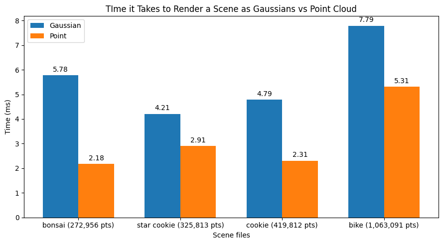

# WebGPU Gaussian Splat Viewer

Rebecca Feng
[LinkedIn](https://www.linkedin.com/in/beckyfeng0803/), [personal website](https://beckyfeng08.github.io/)
* Tested on: Google Chrome Version 155.0.8059.80 (Official Build) (arm64) on Apple M4 Max

https://beckyfeng08.github.io/WebGPU-Gaussian-Splat-Viewer
### Live Demo

[](https://beckyfeng08.github.io/WebGPU-Gaussian-Splat-Viewer)

### Demo Video/GIF

[](TODO)

### Overview
This WebGPU based Gaussian splatting application follows the original [3DGS paper](https://repo-sam.inria.fr/fungraph/3d-gaussian-splatting/), with the following features:
- .ply loading
- rendering point clouds and gaussian splats
- spherical harmonics for view dependent coloring
- preprocess pass to cull gaussians out of camera view, and sort based on depth

To run on your own:

```
git clone https://github.com/beckyfeng08/WebGPU-Gaussian-Splat-Viewer.git
cd WebGPU-Gaussian-Splat-Viewer
npm install
npm run dev
```

### Performance
<!-- Compare your results from point-cloud and gaussian renderer, what are the differences?
For gaussian renderer, how does changing the workgroup-size affect performance? Why do you think this is?
Does view-frustum culling give performance improvement? Why do you think this is?
Does number of guassians affect performance? Why do you think this is? -->
For all evaluations, we time a single frame in milliseconds. Unless otherwise specified, a single frame includes the preprocess and render passes. These were averaged over 200 frames, starting at the 300th frame to account for warm up.

#### Comparing point cloud and gaussian splatting, and number of gaussians in scene
I tested how long it took for a single pass for the gaussian and point cloud rendering methods individually, given our bike and bonsai ply files. All values in milliseconds:
| | bonsai | bike | cookie  | star cookie |
|---|---|---|---|---|
| Gaussian | 4.71 | 7.79 | 4.79 | 4.26 |
| Point | 2.18 | 5.31 | 2.31 | 2.91 |



Overall as we increase the number of points in our scene, it takes a longer amount of time to process it per frame, as expected. Furthermore, it takes a noticeably shorter time to render the points as opposed to the gaussians (since we don't need to do all those calcucations in the fragment shader, and we also don't need two separate passes during each frame).

#### Varying workgroup size
By default, our workgroup size is set to 128.

For our gaussian renderer, we can vary our workgroup size in the preprocess pass. Once again, we take the average over 200 frames, and evaluate only the preprocess pass (commenting out the render pass) for these statistics. These were evaluated using the bike file, which is 1,063,091 points:

| Workgroup size | 24| 32 | 48 | 64 |  128 | 256 |
|---|---|---|---|---|---|---|
| Time (ms) | 2.61| 2.53 | 2.44 | 2.52 | 2.72 | 2.56 | 

We didn't notice too much of a difference when varying the number of workgroups; however, somewhere in between 32 and 48 might give slightly better results. The tested computer is also limited by the number of gaussians it can store at a time, and the bike file is pretty close to its limit, so we cannot test for scenes with a higher gaussian count. Also, the optimal workgroup size will also vary from device to device.

#### View frustum culling
In our code, we culled gaussians when they are not in our scene (cull if they are behind the camera or outside of [-1.2, 1.2] in normalized device coordinate bounds) so that our scene runs faster. Testing with and without culling for the bike scene, a single frame renders 8.68 ms without culling and 7.39 ms with culling.

View is as follows:


### Credits

- [Vite](https://vitejs.dev/)
- [tweakpane](https://tweakpane.github.io/docs//v3/monitor-bindings/)
- [stats.js](https://github.com/mrdoob/stats.js)
- [wgpu-matrix](https://github.com/greggman/wgpu-matrix)
- Special Thanks to: Shrek Shao (Google WebGPU team) & [Differential Guassian Renderer](https://github.com/graphdeco-inria/diff-gaussian-rasterization)
